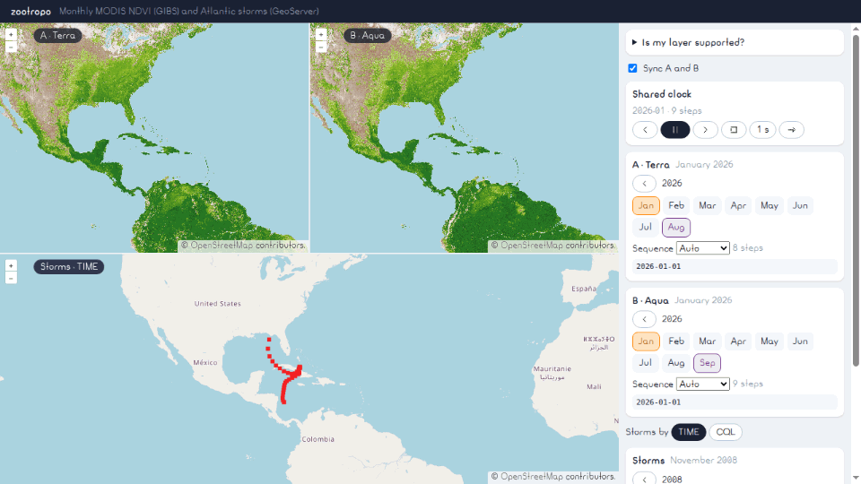

# <picture><source media="(prefers-color-scheme: dark)" srcset=".github/assets/icon-dark.svg"></picture> zootropo

[](https://www.npmjs.com/package/zootropo)
[](https://bundlejs.com/?q=zootropo)
[](LICENSE)

Headless time player for WMS layers: TIME and CQL dates, selection, playback and synced comparison.



**[Live demo](https://ghegar.github.io/zootropo/)**

zootropo owns the state — which dates exist, which year, months or days are selected, the sequence of
steps, play/pause, interval, direction, waiting for the layer to load — and you own every pixel: it
ships no styles, only state, events and ARIA/`data-*` attributes. It works with layers that have a
`TIME` dimension and with layers filtered by a date column through `CQL_FILTER`, and it can drive
several layers with one shared clock to compare them.

## Install

```bash
npm install zootropo
```

Also on [GitHub Packages](https://github.com/GHEgar/zootropo/pkgs/npm/zootropo) as `@ghegar/zootropo`, with the
same entries.

| Entry | What it is | Needs |
|---|---|---|
| `zootropo` | Framework-free core: ISO 8601 parsing, catalog, selection, sequence, player, group | nothing |
| `zootropo/react` | `useTimePlayer`, `usePlayerGroup` and `useUrlSync` | `react >= 19` |
| `zootropo/ol` | `bindWmsTime` and `GetCapabilities` dimension reader | `ol >= 10` |

## Quick start

```ts
import { createTimePlayer } from 'zootropo';
import { bindWmsTime, fetchDimension } from 'zootropo/ol';

const dimension = await fetchDimension('https://example.org/geoserver/wms', 'ws:ndvi');

const player = createTimePlayer({
    catalog: dimension?.values ?? [],
    kind: 'time',
    initial: 'latest',
    mode: 'timeline',
});

bindWmsTime(player, tileWmsSource);
player.play();
```

## Preparing your layers

zootropo needs two things from a layer: the list of dates it has (the catalog) and a way to ask the
server for one of them. There are two ways to get both.

### Path A: a `TIME` dimension

Best for rasters (image mosaics, NetCDF) and for vectors when you control GeoServer.

1. In GeoServer, open the layer → **Dimensions** → enable **Time**. For a vector layer pick the date
   attribute; for a mosaic, the time attribute of its index.
2. Any presentation works: **List** gives exact instants; **Interval and resolution** is expanded to
   instants; **Continuous interval** becomes a range and steps use the granularity you ask for.
3. Values must be ISO 8601 (`2025-03-01`, `2025-03-01T06:00:00Z`).
4. Check it:

   ```bash
   curl -s 'https://example.org/geoserver/ws/wms?SERVICE=WMS&REQUEST=GetCapabilities&VERSION=1.3.0' \
     | grep -A1 '<Dimension name="time"'
   ```

   or in code, `await fetchDimension(url, 'ws:layer')` must return `values`.
5. Create the player with `kind: 'time'` and `catalog: dimension.values`; `bindWmsTime` writes `TIME`.

### Path B: a date column and `CQL_FILTER`

For vector layers in GeoServer without a time dimension.

1. The layer needs a `date` or `timestamp` attribute. Pass its name as `column`.
2. `CQL_FILTER` is a GeoServer vendor parameter; MapServer and QGIS Server do not support it.
3. Get the catalog: WMS does not list the values of a column, but GeoServer's WPS does.
   `fetchColumnDates(url, 'ws:layer', 'column')` asks `gs:Unique` and falls back to WFS without WPS;
   `granularity: 'month'` reduces the list. Any list of ISO dates from your backend works too.
4. Create the player with `kind: 'cql'`, `column` and that list as `catalog`; `bindWmsTime` writes
   `CQL_FILTER` (and `baseCql`, if the layer already has a filter of yours).

### Checklist

| Question | Path A (`TIME`) | Path B (CQL) |
|---|---|---|
| Where do the dates come from? | `GetCapabilities` → `fetchDimension` | `fetchColumnDates` (WPS `gs:Unique`) or your list |
| What does zootropo send? | `TIME=…` | `CQL_FILTER=column >= '…' AND column < '…'` |
| Server | Any WMS with a time dimension | GeoServer |
| Finest level | Whatever the instants carry, down to hours | Day, or hour with timestamps |
| Selecting several dates | Only if the server accepts lists (`multiple`) | Always |
| Typical trap | Service that takes one instant: `multiple: false` | Layer that also has `TIME` on: `cqlTime` |

### Let zootropo check it

```ts
import { inspectLayer } from 'zootropo/ol';

const report = await inspectLayer('https://example.org/geoserver/ws/wms', 'ws:layer');
report.path;    // 'time' | 'cql' | 'both' | 'none'
report.options; // e.g. { kind: 'time', catalog: '2024-01-01/2024-12-01/P1M' }
report.notes;   // e.g. ['cql-needs-cql-time', 'time-hours']
```

It reads the time dimension from `GetCapabilities` and the date attributes from WFS
`DescribeFeatureType`, with the first and last value of each one. Without WFS it still reports the time
dimension and adds `no-wfs`. The same check is in the [live demo](https://ghegar.github.io/zootropo/)
under «¿Mi capa es compatible?», no code needed.

## Core

```ts
import { createTimePlayer } from 'zootropo';

const player = createTimePlayer({
    catalog: '2000-03-01/2025-03-01/P1M,2025-05-01/2026-08-01/P1M',
    kind: 'time',
    initial: 'latest',
    onEvent: event => sync(event),
});

player.subscribe(() => render(player.getSnapshot()));
player.open('2024');
player.select('2024-03', 'toggle');
player.play();
```

Playback changes at any time with `setMode`, `setIntervalMs`, `setDirection`, `setLoop`, `step(delta)`
and `seek(key)`.

### Catalog

The catalog is the list of dates that exist. It accepts the `values` of a WMS `Dimension`, an array of
ISO strings or `{ instants, ranges }`. Comma lists (`2012-01-01T00:00:00Z,2016-01-01T00:00:00Z`) are
read as they are; periodic intervals `start/end/period` are expanded to instants (`P1M`, `P1D`,
`PT6H`…), with month steps clamped to the end of the month instead of drifting. Intervals without a
period, or with more steps than `maxInstants` (10 000), stay as continuous ranges and are answered
lazily. Dates are calendar strings; the model never uses `Date`, so there are no time zone shifts.

### Selection and navigation

Five levels: years, months of a year, days of a month, hours of a day and minutes of an hour, with keys
`YYYY`, `YYYY-MM`, `YYYY-MM-DD`, `YYYY-MM-DDTHH` and `YYYY-MM-DDTHH:MM`. Hours and minutes only appear
when the catalog instants carry a time (radar every 5 minutes, model runs every 6 hours). `items` holds
what the current `view` shows, only what exists in the catalog. `select(key, 'toggle')` adds or removes
keys of the same level and parent; a key from another level or parent replaces the selection.
`multiple: false` keeps one key; `multiple: 'mixed'` lets any keys live together and drops the
ancestors and descendants of a key you add. `open(key)` goes one level down, `back()` one level up.

### Value

| Kind | Value |
|---|---|
| `time` | The instants of the catalog covered by the selection or the current step, in their original format. Instants that are consecutive in the catalog are compacted to `first/last`; continuous ranges are clipped to the period. `compact: false` lists every instant |
| `cql` | Half-open ranges on `column` (`fecha >= '2024-01-01' AND fecha < '2024-02-01'`), contiguous periods merged, joined with `OR`, and `baseCql` added with `AND` |

### Sequence and playback

| Mode | Steps |
|---|---|
| `year`, `month`, `day`, `hour`, `minute` | The units of that level inside the selected parent (every year for `year`), or the selected keys when there are two or more |
| `timeline` | The whole catalog at `granularity` (`month` by default), across years |
| `auto` | Inferred from the selection, then the view; the first mode with at least two steps |

`play()` starts on the selected step when it is part of the sequence, otherwise on the first one.
The interval is clamped to 100–10 000 ms. With `loop: false` the player pauses after the last step.
Changing the selection by hand pauses and goes back to the selection.

### More

| Feature | API | Behavior |
|---|---|---|
| Live layers | `updateCatalog(values)`, `follow` | `PRESENT`, `present`, `current` and `now` resolve to the current time, so `2024-06-01T10:00:00Z/PRESENT/PT5M` keeps growing. `updateCatalog` swaps the catalog without stopping playback: the step and the selection stay when they still exist, and a timeline gets the new steps. With `follow: true`, a selection on the latest date moves to the new latest one. `watchDimension` does the polling |
| Waiting for the layer | `loading()`, `ready()`, `timeoutMs` | The player waits for `ready()` before advancing and pauses with a `timeout` event after `timeoutMs` (30 s). `bindWmsTime` calls both for you |
| Comparing layers | `createPlayerGroup([terra, aqua], { intervalMs: 1000 })` | One clock, interval and direction for every member. The group walks the union of the members' sequences; a member without that date keeps its previous step and reports `stale: true`. It waits until every member is ready; play, pause or a manual selection on a member act on the group |
| Dates in the URL | `syncUrl(player, { param: 'date' })`, `toParam`, `fromParam` | Reads the selection from the query string once the catalog arrives and writes it back with `history.replaceState` (`push` on request). Runs of three or more consecutive keys are compacted: `?date=2024-01..2024-06,2024-09`. In React, `useUrlSync(player)` |
| Labels | `createFormatter({ locale: 'es-MX' }).keys(keys)` | `Intl.DateTimeFormat` with the locale you pass; English by default |

## React

```tsx
import type { TimePlayer } from 'zootropo';
import { useTimePlayer } from 'zootropo/react';

export function Dates({ player }: { player: TimePlayer }) {
    const t = useTimePlayer(player);
    return (
        <>
            <button {...t.getBackProps()}>‹</button>
            <ul {...t.getListProps()}>
                {t.items.map(item => <li key={item.key} {...t.getItemProps(item)}>{item.key}</li>)}
            </ul>
            <button {...t.getPlayProps()}>{t.playing ? 'Pause' : 'Play'}</button>
        </>
    );
}
```

`getStepProps(delta)`, `getIntervalProps()` and `getDirectionProps()` complete the transport. Items
carry `aria-selected`, `aria-current="step"` and `data-selected`, `data-partial`, `data-current`,
`data-contains-current`. Clicking a year selects it and opens its months (`openOnSelect`); double click
or `ArrowRight` opens, `ArrowLeft` goes back. `usePlayerGroup` gives the same transport getters for a
group. Every label can be replaced with `labels`.

## OpenLayers

`bindWmsTime(player, source)` writes `TIME` (or `CQL_FILTER` for `cql` players) with `updateParams`,
counts tile and image loads and calls `loading()`/`ready()`. For a `cql` player on a layer that also has
a time dimension, pass `cqlTime: 'catalog'` (the catalog extent) or a fixed value to send a wide `TIME`
too. `fetchDimension(url, layer)` reads one layer's dimension and `fetchDimensions` every layer's, from a
WMS 1.3.0 `GetCapabilities`, by full and local name. `watchDimension(player, url, layer, { intervalMs })`
reads it again every `intervalMs` (one minute by default, five seconds at least), calls `updateCatalog`
only when the values change, and returns a handle with `stop()`.

For smooth playback use `bindWmsBuffer(player, front, back)` instead of `bindWmsTime`, with two
identical WMS layers added to the map. The front layer shows the current step while the back one, at opacity 0, loads the next. When the
player reaches it, they swap, and the player only waits if the next step was not loaded yet. With the
NDVI layers of the demo the time spent waiting for tiles went from about 65 % to 15 %.

To record the animation as MP4, WebM or GIF, [cartela](https://github.com/GHEgar/cartela) holds the view
with `planHold` and moves the player in `beforeFrame`; its README has the recipe.

## Known limitations

- A GeoServer layer with a `TIME` dimension applies its default time when the request has no `TIME`,
  even with `CQL_FILTER`. Use `cqlTime` when you filter such a layer by CQL.
- With several instants in `TIME`, what the server draws depends on the layer. Some services, like
  NASA GIBS, accept a single instant: use `multiple: false`.

## Development

```bash
npm test
npm run lint
npm run typecheck
npm run demo
npm run e2e
```

The demo plays MODIS NDVI from NASA GIBS on two maps with a shared clock, and Atlantic storms from a
public GeoServer by `TIME` or by CQL.

A `vX.Y.Z` tag that matches `package.json` runs `release.yml`: tests, the GitHub release with that
version's changelog section, npm with provenance (trusted publishing, no token) and GitHub Packages.

## Contributing

Issues are welcome. Open one before sending a pull request.

## License

AGPL-3.0-only © GHEgar
